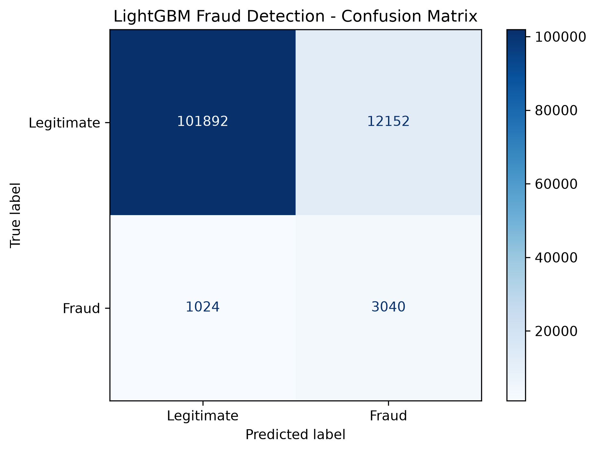
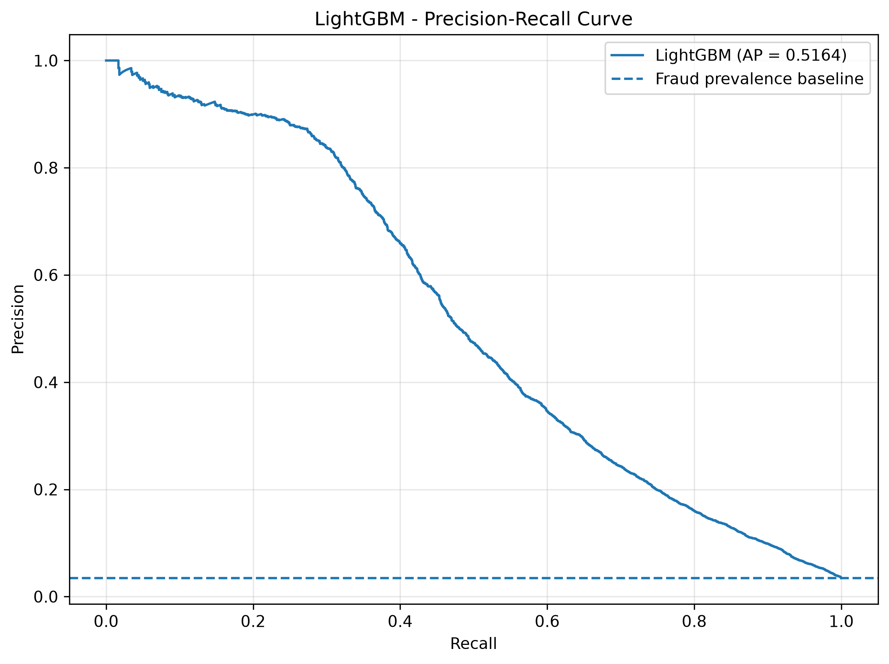
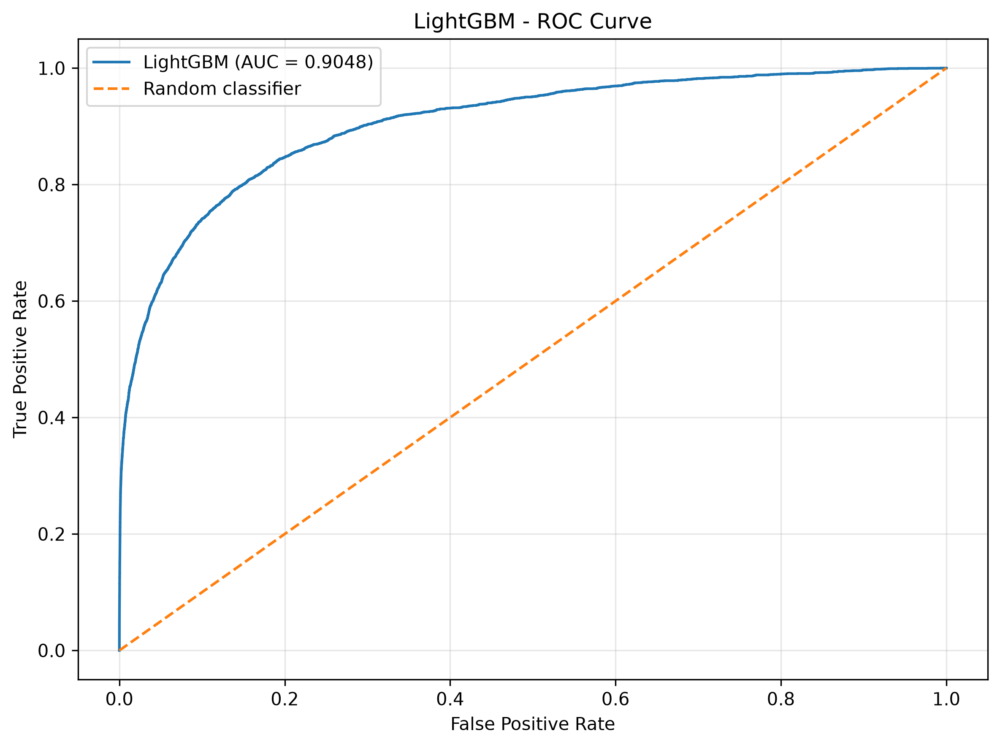
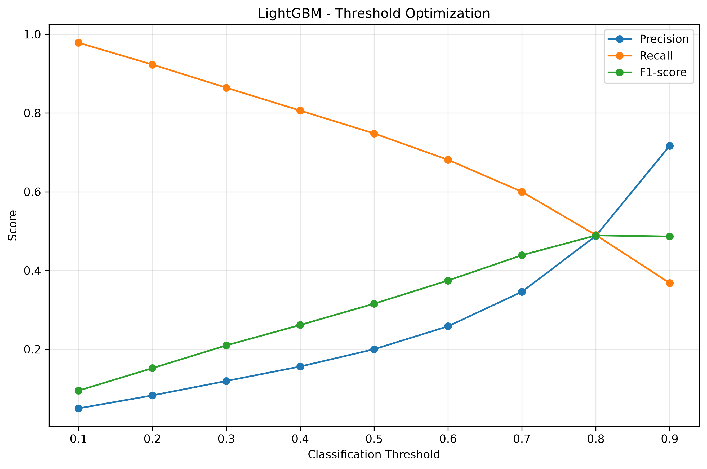
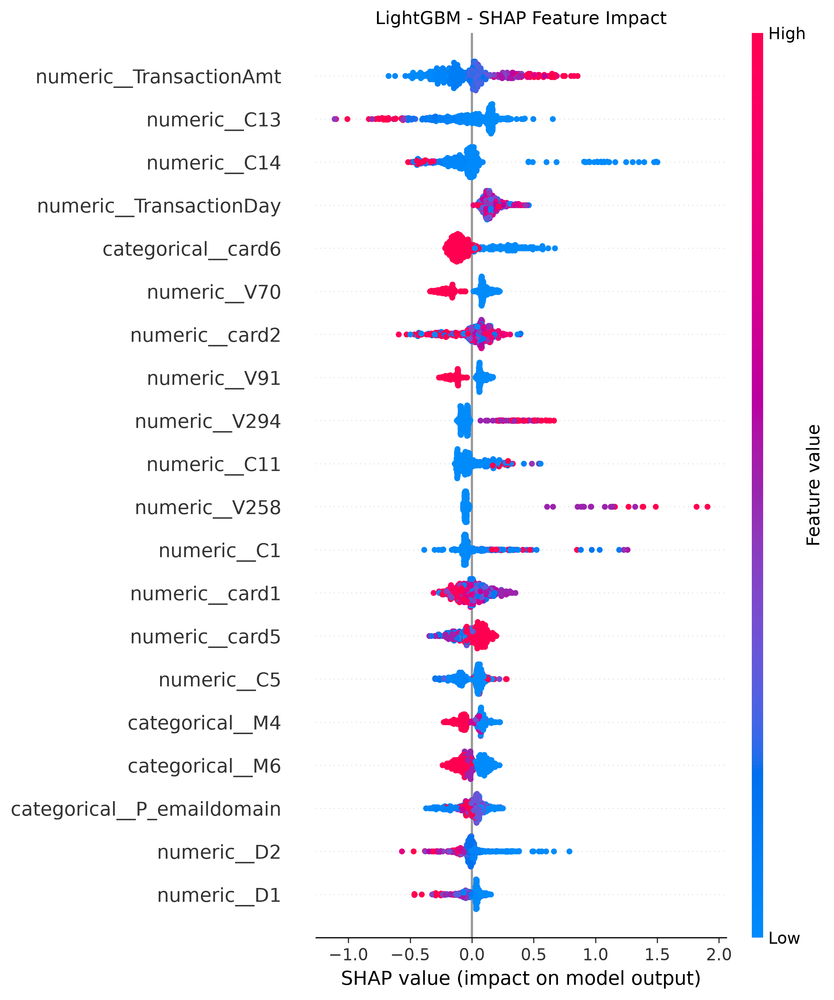
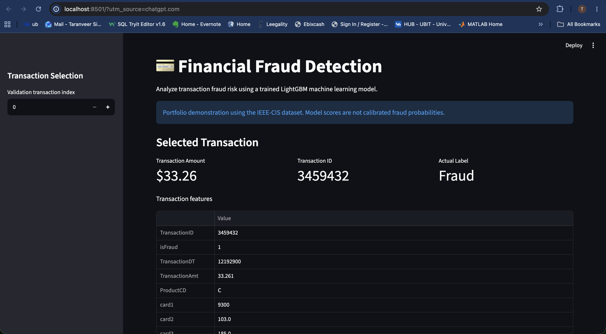
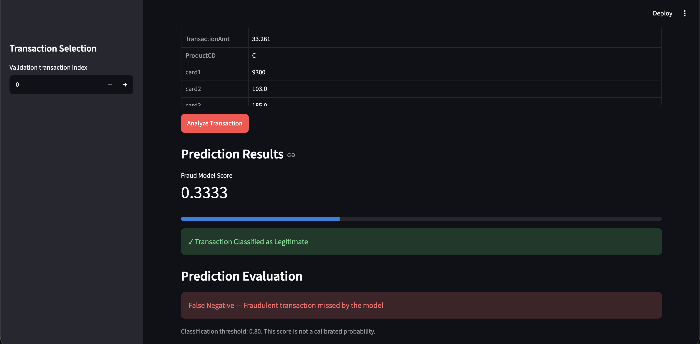

# Financial Fraud Detection | End-to-End Machine Learning

An end-to-end financial fraud detection system built using Python, LightGBM, FastAPI, and Streamlit. The project covers exploratory data analysis, feature engineering, machine learning, explainable AI, and interactive model inference.

## Project Overview

Financial transaction fraud is a highly imbalanced classification problem. This project uses the IEEE-CIS Fraud Detection dataset to identify potentially fraudulent transactions and evaluate the trade-off between detecting fraud and generating false alerts.

The system includes:

- Exploratory data analysis and fraud pattern visualization
- Feature engineering and chronological train-validation splitting
- Baseline and machine learning model comparison
- Threshold optimization and model evaluation
- SHAP-based model interpretability
- REST API for fraud predictions
- Interactive Streamlit dashboard

## Technology Stack

| Category | Technologies |
|----------|-------------|
| Programming | Python, SQL-style tabular analysis |
| Data Processing | Pandas, NumPy |
| Machine Learning | Scikit-learn, LightGBM |
| Explainable AI | SHAP |
| Visualization | Matplotlib, Seaborn |
| Backend | FastAPI, Uvicorn |
| Frontend | Streamlit |
| Model Persistence | Joblib |
| Version Control | Git, GitHub |

## Dataset

**Source:** IEEE-CIS Fraud Detection — Kaggle

Dataset link:
https://www.kaggle.com/competitions/ieee-fraud-detection/data

The dataset contains:

- 590,540 transaction records
- 144,233 identity records
- Transaction amounts, card attributes, addresses, device information, and anonymized transaction features
- Binary fraud labels (`isFraud`)

Approximately 3.5% of transactions are labeled fraudulent, making this an imbalanced classification problem.

The raw dataset is not included in this repository. Download it separately from Kaggle and place the training CSV files in `data/raw/`.

## Machine Learning Pipeline

```text
IEEE-CIS Dataset
       |
       v
Data Loading and Merging
       |
       v
Feature Engineering
       |
       v
Chronological Train/Validation Split
       |
       v
Preprocessing
(Missing Values + Encoding + Scaling)
       |
       v
Model Training
(Dummy Classifier / Logistic Regression / LightGBM)
       |
       v
Model Evaluation
(ROC-AUC / PR-AUC / Precision / Recall / F1)
       |
       v
Explainability
(SHAP + Feature Importance)
       |
       v
FastAPI Inference Service
       |
       v
Streamlit Dashboard
```

## Feature Engineering

The preprocessing pipeline:

- Merges transaction and identity records using `TransactionID`
- Extracts transaction day and hour from `TransactionDT`
- Creates an identity availability indicator
- Calculates the number of missing features per transaction
- Uses a chronological 80/20 training-validation split
- Applies numerical imputation and scaling
- Applies categorical imputation and ordinal encoding
- Fits preprocessing transformations on training data only

## Model Performance

Three models were evaluated on the chronological validation set.

| Model | ROC-AUC | PR-AUC | Precision | Recall | F1 |
|-------|---------|--------|-----------|--------|----|
| Dummy Classifier | 0.5000 | 0.0344 | — | — | — |
| Logistic Regression | 0.8233 | 0.1734 | 0.0881 | 0.7724 | 0.1582 |
| LightGBM | **0.9048** | **0.5164** | **0.2001** | **0.7480** | **0.3157** |

LightGBM achieved the strongest ranking performance, with a PR-AUC of approximately 0.5164.

Because fraudulent transactions represent only about 3.5% of the dataset, PR-AUC is particularly useful for evaluating performance.

The model's original classification metrics were calculated using a 0.50 threshold. A separate threshold analysis explored alternative decision thresholds.

## Model Evaluation

### Confusion Matrix



### Precision-Recall Curve



### ROC Curve



### Threshold Analysis



An experimental threshold of 0.80 was selected for the demonstration API based on the tested F1 scores. It is not a validated production decision threshold.

## Explainable AI

SHAP was used to analyze how individual features contribute to the LightGBM model's predictions.



Transaction amount, transaction timing, and several anonymized transaction attributes are among the influential features.

## API and Dashboard


### Interactive Streamlit Dashboard

The dashboard allows users to explore validation transactions and generate fraud predictions through the FastAPI backend.

**Dashboard Overview**



**Fraud Prediction and Evaluation**



The application displays:
- Transaction details and actual fraud labels
- LightGBM fraud scores and classifications
- Prediction correctness (TP, TN, FP, FN)
- Experimental classification threshold of 0.80


The trained LightGBM model is served through a FastAPI application.

### API Endpoints

| Method | Endpoint | Description |
|--------|----------|-------------|
| GET | `/` | API information |
| GET | `/health` | Health check |
| GET | `/model-info` | Model metadata |
| POST | `/predict` | Transaction fraud prediction |

The Streamlit dashboard allows users to select validation transactions, view transaction details, request fraud scores, and compare model predictions with known fraud labels.

Model scores are not calibrated probabilities.

## Project Structure

```text
financial-fraud-detection/
├── api/
│   ├── main.py
│   └── test_prediction.py
├── dashboard/
│   └── app.py
├── data/
│   └── raw/
├── models/
├── notebooks/
│   └── 01_exploratory_analysis.ipynb
├── reports/
│   ├── figures/
│   ├── model_comparison.csv
│   └── threshold_comparison.csv
├── src/
│   ├── preprocess.py
│   ├── train.py
│   └── evaluate.py
├── tests/
├── requirements.txt
└── README.md
```

## Installation and Setup

### 1. Clone the repository

```bash
git clone https://github.com/Taranveer-Singh-Gill/financial-fraud-detection.git
cd financial-fraud-detection
```

### 2. Create a virtual environment

```bash
python3.12 -m venv .venv
source .venv/bin/activate
```

### 3. Install dependencies

```bash
python -m pip install -r requirements.txt
```

### 4. Download the dataset

Download the IEEE-CIS Fraud Detection dataset from Kaggle.

Place these files in `data/raw/`:

```text
data/raw/train_transaction.csv
data/raw/train_identity.csv
```

### 5. Train the model

```bash
python -m src.train
```

### 6. Evaluate the model

```bash
python -m src.evaluate
```

### 7. Start FastAPI

```bash
python -m uvicorn api.main:app --reload
```

API documentation:
http://127.0.0.1:8000/docs

### 8. Start Streamlit

Open another terminal, activate the virtual environment, and run:

```bash
python -m streamlit run dashboard/app.py
```

Dashboard:
http://localhost:8501

### 9. Test API predictions

With FastAPI running:

```bash
python -m api.test_prediction
```

## Limitations and Future Improvements

- The IEEE-CIS dataset is historical and does not represent live banking transactions.
- Model scores are not calibrated fraud probabilities.
- The 0.80 classification threshold is experimental.
- The dashboard uses validation transactions for demonstration.
- The API expects the same engineered feature schema used during training.
- Production deployment would require monitoring, authentication, data validation, and model drift detection.
- Future improvements could include probability calibration, automated testing, model monitoring, and cloud deployment.

## Author

**Taranveer Singh Gill**

[GitHub](https://github.com/Taranveer-Singh-Gill)